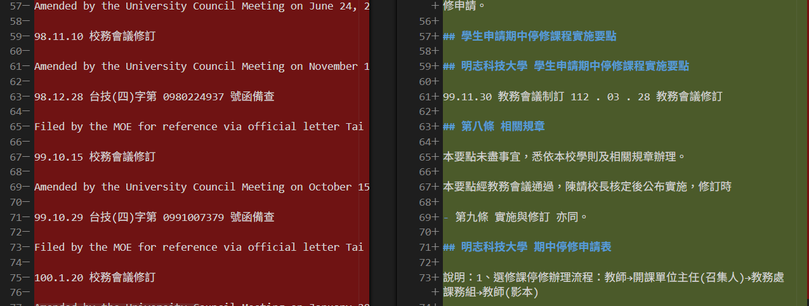
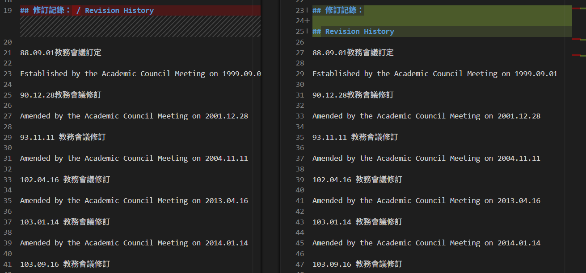
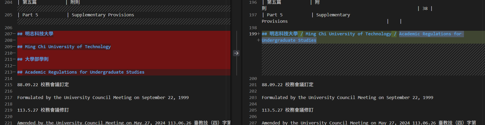
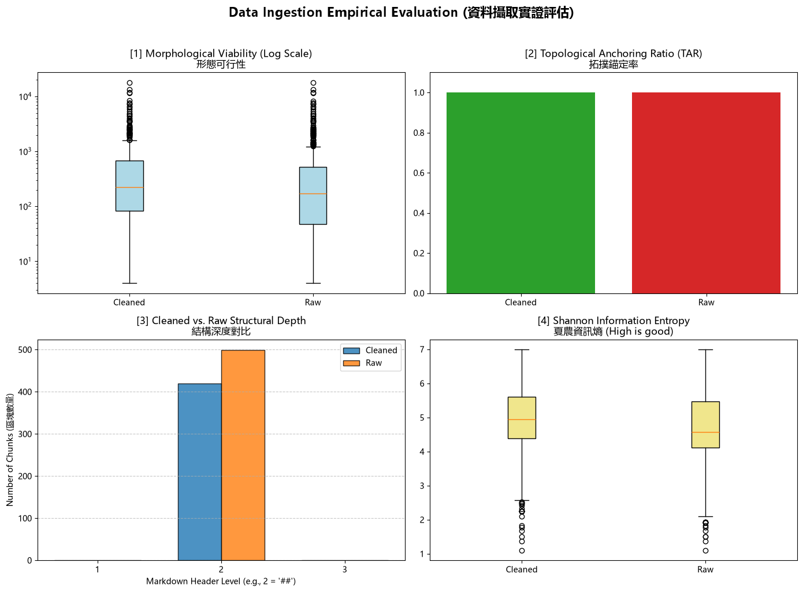

# 資料前處理報告 (Data Preparation Report)

> 期中評量 · NLP 自然語言處理 115-S1
> 填寫方式：請把所有「（ ）」與 `___` 替換成你自己的內容，並刪除 `>` 開頭的說明文字。

- **學號 / 姓名**:   U12627038 / 劉恆佑
- **專案名稱**：明志科技大學校園規章資料前處理
- **完成的任務**：- [x] 1-A 頁首頁尾清除　- [x] 1-B 雙語標題合併　- [x] 1-C 雙語條文合併

---

## 1. 資料集概覽 (Dataset Overview)

> 數字來源：`01_Data_Ingestion.ipynb` 第 2 節 (掃描 PDF) 與第 5 節 (批次處理) 的輸出。

| 類別 (Cluster) | PDF 數量 | 清洗前 chunk 數 | 清洗後 chunk 數 |
|Academic_Affairs     3             113              81
|Library_Information  3            309               277
|Student_Affairs      3              77              61
|**合計**             9              499              419

**問題 (2–3 句)：** 清洗後 chunk 數量變少了多少？是哪個任務造成的？有沒有哪個任務**不影響** chunk 數量？為什麼？
A:清洗後的 chunk 數量由 499 個減少為 419 個，共減少 80 個，約減少 16.03%。
任務 1-A 刪除帶有 `##` 的獨立頁首頁尾標題，以及任務 1-B 合併連續的中英文標題，都可能減少切塊邊界。
任務 1-C 合併文字與英文清單條文，但不移除 `##` 標題邊界，因此依照目前的切塊規則，不影響 chunk 數量。
> 提示：chunk 是用什麼規則切開的？請看 notebook 第 5 節的 `chunking_regex`。

___

## 2. 清洗步驟 (Cleaning Steps)

> **截圖來源：** `data/interim/<類別>/` 中的 `raw_*.md` (清洗前) 與 `cleaned_*.md` (清洗後)，也就是批次處理存下的**真實檔案**。

>
> **[重要] 不可使用 notebook 中的範例。** notebook 任務 1-A、1-B、1-C 的測試文字 (第二十一條、明志科技大學 / Ming Chi University of Technology、第十五條 / Article 15) **不能**作為你的截圖。請在真實檔案中**另找一處**，可以是其他 PDF 的檔案。使用範例的截圖**不給分**。
>
> **截圖方法 (VS Code 比較檢視)：**
> 1. 在檔案總管對 `raw_<檔名>.md` 按右鍵 → **Select for Compare**。
> 2. 對同一份文件的 `cleaned_<檔名>.md` 按右鍵 → **Compare with Selected**。
> 3. 左右並排顯示，紅色 = 刪除，綠色 = 新增或修改。按 `Ctrl + F` 搜尋，找到該任務造成的變更。
> 4. 每個任務截**一張**圖，存到 `reports/figures/`，**檔名必須完全相同** (否則圖片不會顯示)：
>    * 任務 1-A → `1a_compare.png`
>    * 任務 1-B → `1b_compare.png`
>    * 任務 1-C → `1c_compare.png`

### 2.1 任務 1-A：頁首頁尾溢出清除
檔名：`raw_A231060004_學生申請期中停修課程實施要點.md` 與 `cleaned_A231060004_學生申請期中停修課程實施要點.md`；搜尋的文字：`學生申請期中停修課程實施要點`- 截圖：
- 改變了什麼：刪除清洗前第 7 行及第 57 行的獨立標題「## 學生申請期中停修課程實施要點」，其他內容保留。
- 這對之後的問答檢索有什麼幫助：移除重複的法規名稱，可減少沒有實質條文的標題區塊與多餘切塊邊界。本文件的 chunk 數量由 13 個減少為 11 個。
- 這個任務有沒有改錯的地方：有疑似誤刪。在 `raw_A231060004_學生申請期中停修課程實施要點.md` 第 7 行，該標題位於規章編號與制定部門之間，看起來是封面的正式標題，也被清洗規則刪除。這表示規則未區分正式標題與重複頁首頁尾。
### 2.2 任務 1-B：雙語標題合併
- 檔名：`raw_A232060013_學生抵免學分辦法.md` 與 `cleaned_A232060013_學生抵免學分辦法.md`；搜尋的文字：`修訂記錄`
- 截圖：
- 改變了什麼：將分開的「## 修訂記錄：」與「## Revision History」合併為「## 修訂記錄： / Revision History」。截圖左側為清洗後，右側為清洗前。
- 這對之後的問答檢索有什麼幫助：避免中文標題單獨形成沒有內文的 chunk，讓中英文標題與後方修訂紀錄保留在同一個區塊。
- 這個任務有沒有改錯的地方：有。在 `cleaned_A232060013_學生抵免學分辦法.md` 搜尋「Article 4 Principles」，可看到「Article 4 Principles of Course Waiver and Credit Transfer」與「Principles of course waiver」被合併。兩者是英文條文標題與其子標題，並非中英文對照；目前規則只檢查下一個標題是否以英文字母開頭，因此也會誤合併這類標題。

### 2.3 任務 1-C：雙語條文合併
截圖：
改變了什麼：清洗前第 211 行的獨立標題「## 大學部學則」被刪除，清洗後已沒有該行。
這對之後的問答檢索有什麼幫助：若刪除的是重複頁首頁尾，可減少無關文字與多餘的切塊邊界，降低檢索干擾。
這個任務有沒有改錯的地方：有疑似誤刪。在 raw_A232020018_大學部學則.md 搜尋「大學部學則」，第 211 行位於校名與修訂日期之間，應屬正式標題。清洗規則只依整行文字是否符合文件名稱判斷，未區分正式標題與重複頁首頁尾，因此也將這個標題刪除。

## 3. 評估指標與 AI 解讀查證 (Metrics & Verifying the AI's Interpretation)

### 3.1 指標數據表

> 數字來源：專案根目錄的 `metrics.json`。[1]、[2] 必填；[3]、[4] 選填。
> 「參考值」由老師在課堂上公布 (完成全部任務的結果)。

| 指標 | Raw | Cleaned（你的） | Cleaned（參考值） |
|---|---|---|---|
| [1] 中位數長度 Median Length | 171.0 | 226.0 | 
| [2] 拓撲錨定率 TAR | 100.00% | 100.00% | 
| [3] 深度變異量 SDV | 0.00 | 0.00 | 
| [4] 中位數資訊熵 Entropy | 4.56 | 4.94 

> **儀表板截圖：** 你自己的 `01_Data_Ingestion.ipynb` **第 6 節**輸出的 4 拼圖儀表板 (第 8 週執行並保留的輸出)。截圖後存為 `reports/figures/dashboard.png`。第 3.2 節也會用到這張截圖。



你的 Cleaned 結果與參考值一致嗎？若一致，寫「一致」；若不一致，找出原因。（1 句）

___

### 3.2 AI 的解讀

> 把第 3.1 節的儀表板截圖 (`dashboard.png`) 交給 AI，請它解讀結果。將 AI 的回答**完整貼在這裡**，並註明使用的 AI 工具。

- 使用的 AI 工具：ChatGPT
1. 清洗後的 chunk 長度中位數由 171 字元增加到 226 字元，表示清洗後的典型區塊較長。配合清洗前後 chunk 總數由 499 個減少為 419 個，可看出清洗改變了文字的分組方式；但這不能直接證明所有區塊都更完整。

2. Raw 與 Cleaned 的 TAR 都是 100%，表示依目前程式的判定，所有 chunk 都以 Markdown 標題符號開頭。這項指標只能反映標題符號是否存在，不能證明標題正確、內文完整，或中英文對應正確。

3. 結構深度圖顯示，清洗前後的 chunk 開頭標題均為第 2 層，因此 SDV 都是 0。這表示目前觀察到的標題深度一致，但不能單憑 SDV 為 0 判斷文件結構良好，因為它也可能反映轉換後的標題階層被壓平。

4. 資訊熵中位數由 4.56 增加到 4.94，表示清洗後典型 chunk 的字元分布有變化。這裡計算的是字元的 Shannon entropy，並不是語意正確率，因此資訊熵增加不能直接證明內容更正確或檢索效果更好。

5. 長度圖中，清洗後仍有超過一萬字元的離群區塊；資訊熵圖也仍有低資訊熵的區塊。這表示清洗後仍需要檢查過長表格、重複文字及只有標題的區塊。

整體而言，這些指標可以協助發現資料結構與字元分布的變化，但仍須回到原始與清洗後文件檢查，並透過後續實際問答測試確認檢索效果。
```

### 3.3 你的查證 (至少兩點)

**查證 1**
AI 的說法：Raw 與 Cleaned 的 TAR 都是 100%，但這只能反映 chunk 是否以標題符號開頭，不能證明內容完整。
- 我查了什麼：查看 `01_Data_Ingestion.ipynb` 第 6 節的 `get_tar()` 函式。程式使用 `re.match(r'^\s*#+', record["text"])`，檢查 chunk 開頭是否有 `#`，再除以 chunk 總數。
- 結論：正確，因為程式沒有檢查標題是否合理、是否有內文或中英文是否對齊，所以 TAR 為 100% 不代表所有 chunk 都沒有問題。

**查證 2**
 AI 的說法：資訊熵由 4.56 增加到 4.94，不能直接證明內容更正確或檢索效果更好。
- 我查了什麼：查看 `01_Data_Ingestion.ipynb` 第 6 節的 `get_entropy()` 函式。它使用 `Counter(text)` 計算每個字元的次數，再依字元出現機率計算 Shannon entropy。
- 結論：正確，因為這個計算只使用字元分布，沒有檢查文字意思、條文配對或實際問答結果，因此不能直接當作語意正確率或檢索準確率。


### 3.4 實際證據：你被指定的 chunk

- **SEED**：116

**(a) 很長的 chunk**

- 資料檔 (JSON)：`data/processed/Academic_Affairs/cleaned_A232060013_學生抵免學分辦法_processed.json`
- 位置：第 35 個（從 0 開始數）
- 長度：13465 字元
- 驗證碼：`0ecb9d36`
- 閱讀用檔案：`data/interim/Academic_Affairs/cleaned_A232060013_學生抵免學分辦法.md`
- 從第 342 行開始
- 前 3 行內容：

## 明 志 科 技 大 學 科 目 替 代 申 請 書

|                      |                      |                      |                         |                         |        

- 這是什麼樣的文字？為什麼會這麼長？

這是「明志科技大學科目替代申請書」，包含學生資料、替代前後的科目、核簽流程及審查結果。表格轉成 Markdown 後，含有大量空白、分隔符號與重複欄位文字；程式只在 `##` 標題前切塊，沒有設定長度上限，因此整張表格形成一個 13465 字元的 chunk。

- 之後做問答檢索時，這麼長的 chunk 可能造成什麼問題？

大量空白、格式符號與重複文字可能增加處理負擔，降低有效資訊比例。整張表格放在同一個 chunk，也可能使檢索難以精確定位特定欄位，並在超過模型輸入限制時被截斷。

**(b) 資訊熵很低的 chunk**
- 資料檔 (JSON)：`data/processed/Academic_Affairs/ cleaned_A232060013_學生抵免學分辦法_processed.json`
- 位置：第 3 個（從 0 開始數）
- 資訊熵：2.25
- 驗證碼：`cbfc7f2f`
- 閱讀用檔案：`data/interim/Academic_Affairs/cleaned_A232060013_學生抵免學分辦法.md`
- 從第 65 行開始
- 內容：
## Table of Contents

錄

頁次

Page

| 第一條    | 依據                                                                                               |   1 |
|-----------|----------------------------------------------------------------------------------------------------|-----|
| Article 1 | Basis                                                                                              |     |
| 第二條    | 適用對象                                                                                           |   1 |
| Article 2 | Applicability                                                                                      |     |
| 第三條    | 抵免學分數                                                                                         |   2 |
| Article 3 | Number of Credits for Transfer                                                                     |     |
|           | 第四條 科目抵免原則                                                                                |   4 |
| Article 4 | Principles of Course Waiver and Credit Transfer                                                    |     |
| 第五條    | 新生抵免申請                                                                                       |   6 |
|           | Article 5 Application for Credit Transfer and Course Waiver                                        |     |
| 第六條    | 國外修課學分與成績登錄處理原則                                                                     |   6 |
|           | Article 6 Regulations for the Transfer of Credits and Grade  Registration for Courses Taken Abroad |     |
| 第七條    | 科目替代                                                                                           |   7 |
| Article 7 | Subject substitution                                                                               |     |
| 第八條    | 審核方式                                                                                           |   7 |
| Article 8 | Evaluation Methods                                                                                 |     |
| 第九條    | 注意事項                                                                                           |   8 |
| Article 8 | Dos and Don'ts                                                                                     |     |
| 第十條    | 相關規定                                                                                           |   8 |
| Article 9 | Unsettled Matters                                                                                  |     |
| 第十一條  | 實施與修訂                                                                                         |   9 |
|           | Article 10 Implementation and Amendment                                                            |     |

為什麼它的資訊熵這麼低？它對問答檢索有用嗎？
這個 chunk 是中英文目錄表格，含有大量用於欄位對齊的空白，以及重複的表格符號、分隔線和條號。程式以字元出現機率計算資訊熵，當空白或少數符號占比較高時，資訊熵就會偏低，因此得到 2.25。
它仍有用途，可以協助查找條文主題、條號與頁次，但沒有各條文的完整規定，不能單獨作為回答具體規則的依據。檢索到目錄後，仍應找到對應正文；低資訊熵不代表這個 chunk 完全沒有價值。

## 4. 一個尚未解決的問題 (One Remaining Problem)

> 打開 `data/interim/` 中任一個 `cleaned_*.md` (與 `data/processed/` 的 JSON 內容相同，但有正常換行，比較好讀)，找出一個清洗後**仍然有問題**的 chunk。
> 每個 chunk 從一個 `## ` 標題開始，到下一個 `## ` 標題之前結束。
> 例如：只有標題沒有內文、表格亂掉、中英文沒有對齊、還有殘留的頁首頁尾、斷行造成的多餘空白，或是**清洗造成的錯誤** (誤合併、誤刪除)。
> **不可**使用第 3.4 節的兩個 chunk。

- **檔名**：`cleaned_A232060013_學生抵免學分辦法.md`
- **從第幾行開始**：197
- **標題**：`## Article 4 Principles of Course Waiver and Credit Transfer / Principles of course waiver`
- **我是怎麼找到的**：比較清洗前後檔案，搜尋「Article 4 Principles」，發現清洗後將兩個不同層級意義的英文標題接在一起。
- **問題 chunk（貼上部分內容）**：

```text
## Article 4 Principles of Course Waiver and Credit Transfer / Principles of course waiver

The courses allowed for waiver shall include both required and elective courses.
```
- **問題是什麼**：第四條的英文總標題與「Principles of course waiver」子標題被合併，兩者不是中英文對照，合併後無法清楚區分條文名稱與子項目。
- **可能的原因**：任務 1-B 的正則表示式只檢查連續標題，以及第二個標題是否以英文字母開頭，沒有確認第一個標題是否為中文，也沒有判斷兩個標題是否為對應翻譯。
- **具體的修正方法**：在合併前增加條件，要求第一個標題包含中文字、第二個標題為對應英文；若包含條號，還需核對條號一致。兩個都是英文的標題先保留分開，避免誤合併。
- **對問答檢索的影響**：不同意義的標題混在同一行，可能讓區塊的主題標示不清楚，影響檢索定位與回答時的條文引用。

## 5. AI 協作 (AI Collaboration)
- 本次作業的 AI 協作紀錄請見 [`AI_USAGE.md`](AI_USAGE.md) 的「Week 04 / 08」與「Week 09」段落。
- 這次使用 AI 最大的收穫或教訓是 ___（請具體：例如提示詞中哪一段最關鍵、AI 哪一句解讀不正確）
- 本次作業的 AI 協作紀錄請見 [`AI_USAGE.md`](AI_USAGE.md) 的「Week 04 / 08」與「Week 09」段落。
- 這次使用 AI 最大的收穫是，提供真實檔案、程式和執行輸出，比只描述問題更容易得到有證據的分析。例如 TAR 雖然達到 100%，但查看程式後才知道它只檢查開頭是否有標題符號，不能代表內容完整。另外，比較清洗前後文件也發現規則可能誤刪正式標題或合併不同的英文標題，因此不能只看指標就認為清洗成功。
